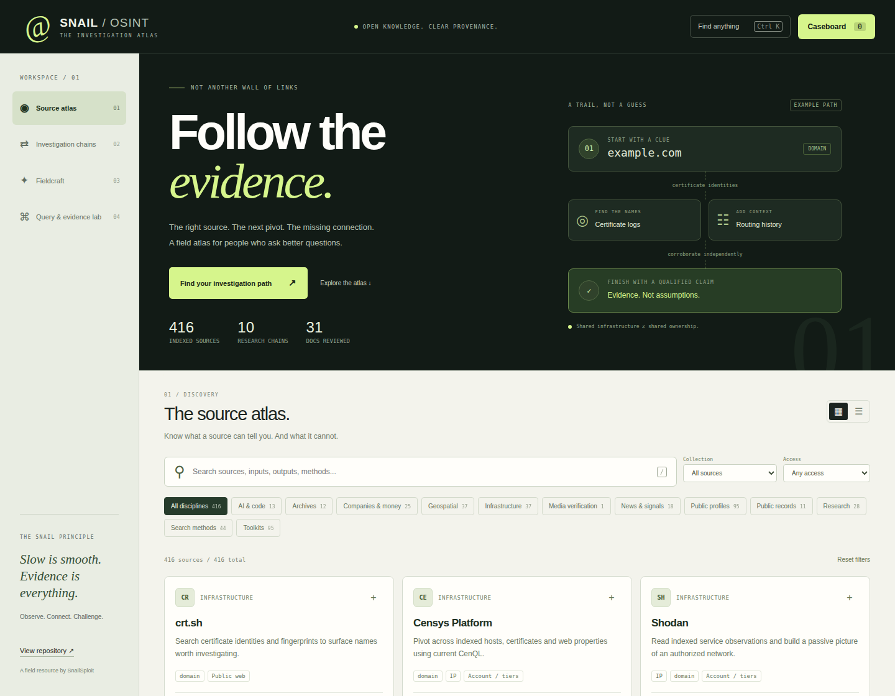

# Snail OSINT

### Aggregate. Deduplicate. Correlate.

**An open-source OSINT tool pipeline, backed by a large source directory.**
Give specialist tools the inputs they understand, combine their outputs, collapse duplicated identifiers without losing evidence, and surface cross-source pivots. The pipeline is the core project; the browser workspace is a companion.

**[Run the tool pipeline](docs/tool-pipeline.md)** · [Tool registry](pipeline/registry.json) · [CLI source](scripts/osint_pipeline.mjs) · [Browse the original directory](#table-of-contents) · [Open the browser workspace](https://snail-osint-atlas.pages.dev/)

## What actually runs

| Component | Status | Scope |
| --- | --- | --- |
| **Tool pipeline** | **Tested local CLI** | Aggregates normalized identifiers, deduplicates entities while retaining source records, and reports exact cross-source overlaps. |
| **Telegram** | Import + optional live public-channel reader | Telegram Desktop public-channel exports; explicitly chosen bot-response exports marked unverified; bounded public-channel reads via local Telethon credentials. No automated third-party bot conversations. |
| **JAR inspection** | Local static analysis | Extracts JAR metadata, package names and embedded identifiers without running Java code. Signing artifacts are listed, not authenticated. |
| **Shodan / Hunter** | JSON import only | Consumes operator-supplied Shodan indexed-asset and Hunter domain-search exports. **No live API connectors yet.** |
| **Gitleaks** | Redacted JSON import | Imports findings from separately authorized scans without copying credential values. Does not scan or validate tokens. |
| **DNS / RDAP / routing** | Bounded live public-record lookups | Reuses the existing exact-domain/IP Atlas collector. Requires explicit scope confirmation; not a port scanner. |
| **Source directory** | Browsable catalog | The original OSINT collection and curated dossiers. A listing is **not** a working tool integration or a verified-live source. |
| **Browser workspace (Atlas)** | Live, separate frontend | Search source cards, inspect research chains, run existing bounded public-record workflows, and use the synthesis lab. It **does not execute the local specialist CLI**. |

**Not yet implemented:** a general executable 300-tool registry, automated third-party Telegram bot queries, a browser-fingerprinting pack, live Shodan/Hunter queries, or a web UI that orchestrates local CLI tools. These are development targets, not shipped features.

## Run the specialist pipeline

**Requirements:** Node.js 22+; Python 3.10+ for static JAR inspection. The baseline works with supplied files and does not require paid API credentials.

```bash
# Inspect the registered tools and their execution modes
node scripts/osint_pipeline.mjs --list-tools

# Combine two real input sources into one evidence-linked case
node scripts/osint_pipeline.mjs \
  --telegram-public channel.json @publicchannel \
  --jar application.jar \
  --out case.json

# Reuse the existing scoped domain collector
node scripts/osint_pipeline.mjs \
  --live-domain example.org --confirm-scope --out domain-case.json
```

Inputs are supplied by the investigator; the example filenames are placeholders, **not included investigation data**. Output includes typed entities, original source references, duplicate counts, overlaps, and per-tool execution status. A shared identifier is an investigative lead—not proof of common ownership or identity.

See the [complete tool-pipeline guide](docs/tool-pipeline.md) for Telegram public-channel collection, bot-export requirements, offline imports, privacy boundaries, and test commands. The [adapter registry](pipeline/registry.json) identifies which entries are runnable, optional, or import-only.

## The source directory and browser workspace

The original awesome-list resource directory is preserved below. Its current Atlas catalog contains **416 indexed entries**, including imported legacy links that have not been individually reviewed. These are **resources, not 416 integrations**. It also provides investigation chains, fieldcraft notes, and scoped query recipes.

**[Browse the OSINT workspace](https://snail-osint-atlas.pages.dev/)** · [Research chains](https://snail-osint-atlas.pages.dev/#view=chains) · [Existing live DNS/IP investigations](https://snail-osint-atlas.pages.dev/#view=run) · [Synthesis lab](https://snail-osint-atlas.pages.dev/#view=synthesis) · [Frontend documentation](ATLAS.md)

[](https://snail-osint-atlas.pages.dev/)

**Why keep Atlas?** It is a useful catalog browser and research companion. It isn't the identity of the repository, and a hosted page must never imply that local Telegram, artifact-inspection, or third-party API adapters ran when they did not. Once a proper pipeline UI exists, this workspace can become a view over its results.

## Development priorities

1. Improve adapter contracts and failure reporting without flattening specialists into generic search.
2. Add genuinely executable packs for public web fingerprints, repositories, email discovery, and IP research; distinguish passive, authenticated, local, and active collectors.
3. Expand Telegram public-content coverage and safely import independently sourced evidence.
4. Add bounded downstream pivots and source-aware correlation once each collector is tested.

**Repository policy:** one repository, `main` as the integration branch, preserved original list, source-linked findings, no fabricated attribution, and no credential dumps.

---

## Start here

| Your task | Reference |
| --- | --- |
| Plan an evidence-driven investigation | [OSINT field guide](docs/field-guide.md) · [Advanced techniques](advanced-osint-techniques.md) |
| Understand a domain or infrastructure footprint | [Website security](#website-security) · [Shodan searches](shodan-dorks.md) |
| Research organizations and public profiles | [Research tools](#research-and-investigative-tools) · [Social search](#social-media-search) |
| Discover public repository metadata | [GitHub search reference](github-dorks.md) |
| Learn search-engine operators | [Google dorks](google-dorks.md) · [Other engines](other-search-engines-dorks.md) |
| Document claims and corroboration | [Investigation report template](docs/report-template.md) |
| Submit a tool or fix a broken link | [Contributing](CONTRIBUTING.md) · [Report an issue](https://github.com/SnailSploit/Awesome-Snail-OSINT/issues) |

**Resource status:** This is a community-maintained collection, not a verified-live service catalog. Links, query syntax, access terms, and pricing can change. Read the [resource quality policy](docs/resource-quality.md) before relying on a listing.

<details>
<summary>Show the original Snail banner</summary>

```


⠀⠀⠀⠀⠀⠀⠀⠀⠀⠀⠀⠀⠀⠀⠀⠀⠀⠀⠀⠀⠀⠀⠀⠀⠀⠀⠀⢀⣀⣀⣀⠀⠀⠀⠀⠀⠀⠀⠀⠀⠀⠀⠀⠀⠀⠀⠀⠀⠀⠀⠀
⠀⠀⠀⠀⠀⠀⠀⢀⣀⣀⠀⠀⠀⠀⠀⠀⠀⠀⠀⠀⠀⠀⠀⠀⠀⠀⠀⣀⣤⣶⣾⣿⠿⠿⠿⠿⠿⠿⠿⣿⣷⣶⣤⣀⠀⠀⠀⠀⠀⠀⠀⠀⠀⠀⠀⠀⠀
⠀⠀⠀⠀⠀⠀⢸⣿⣿⣿⣷⠀⠀⠀⠀⠀⠀⠀⠀⠀⠀⠀⠀⠀⣠⣴⣿⠿⠛⠉⠀⠀⠀⠀⠀⠀⠀⠀⠀⠀⠀⠉⠛⠿⣿⣶⣄⠀⠀⠀⠀⠀⠀⠀⠀⠀⠀
⠀⠀⠀⠀⠀⠀⠘⠿⢿⣿⣿⠀⠀⠀⠀⠀⠀⠀⠀⠀⠀⠀⢀⣼⣿⠟⠁⠀⠀⠀⠀⠀⠀⠀⠀⠀⠀⠀⠀⠀⠀⠀⠀⠀⠈⠙⢿⣷⣄⠀⠀⠀⠀⠀⠀⠀⠀
⣶⣿⣿⣦⠀⠀⠀⠀⠀⣿⡿⠀⠀⠀⠀⠀⠀⠀⠀⠀⠀⠀⣾⣿⠁⠀⠀⠀⠀⠀⠀⠀⠀⠀⠀⠀⠀⠀⠀⠀⠀⠀⠀⠀⠀⠀⠀⠹⣿⣦⡀⠀⠀⠀⠀⠀⠀
⠻⣿⣿⣿⡇⠀⠀⠀⠀⣿⡇⠀⠀⠀⠀⠀⠀⠀⠀⠀⠀⣰⣿⡇⠀⠀⠀⠀⠀⠀⠀⠀⠀⢀⣠⣴⣶⣶⣶⣶⣶⣤⣀⡀⠀⠀⠀⠀⠈⣿⣷⠀⠀⠀⠀⠀⠀
⠀⠀⠀⢻⣿⡄⠀⠀⠀⣿⣿⡀⠀⠀⠀⠀⠀⠀⠀⠀⠀⣿⣿⠀⠀⠀⠀⠀⠀⠀⢀⣤⣾⡿⠟⠋⠉⠁⠀⠈⠉⠛⠿⣿⣦⡀⠀⠀⠀⠸⣿⣇⠀⠀⠀⠀⠀
⠀⠀⠀⠘⣿⣷⡀⢀⣤⣼⣿⣷⣤⣤⣀⠀⠀⠀⠀⠀⠀⣿⣷⠀⠀⠀⠀⠀⠀⣰⣿⡟⠁⠀⠀⠀⠀⣀⣀⣀⡀⠀⠀⠈⠻⣿⣦⠀⠀⠀⢹⣿⡆⠀⠀⠀⠀
⠀⠀⠀⠀⠈⢻⣿⣿⠟⠋⠉⠉⠉⠛⢿⣷⣄⠀⠀⠀⠀⢿⣿⡀⠀⠀⠀⠀⣴⣿⠏⠀⠀⠀⣠⣶⣿⠿⠛⠻⣿⣷⣄⠀⠀⠹⣿⡇⠀⠀⠈⣿⣇⠀⠀⠀⠀
⠀⠀⠀⠀⢠⣾⡟⠁⠀⠀⠀⠀⠀⠀⠀⠹⣿⣦⡀⠀⠀⠸⣿⣇⠀⠀⠀⢠⣿⡏⠀⠀⠀⣼⣿⠟⠁⠀⣠⡀⠀⠻⣿⡆⠀⠀⣿⣷⠀⠀⠀⣿⣿⠀⠀⠀⠀
⠀⠀⠀⠀⢸⣿⠁⠀⠀⠀⠀⠀⠀⠀⠀⠀⠘⣿⣧⣠⣴⣶⣿⣿⡆⠀⠀⢸⣿⠁⠀⠀⢸⣿⠇⠀⢀⣾⡿⠃⠀⠀⣿⡇⠀⠀⣿⡿⠀⠀⢀⣿⡇⠀⠀⠀⠀
⠀⠀⠀⠀⢸⣿⡆⠀⠀⠀⠀⠀⠀⠀⠀⠀⠀⢹⣿⡿⠋⠉⠈⠉⠀⠀⠀⢸⣿⡀⠀⠀⢸⣿⠀⠀⢸⣿⣇⣀⣀⣾⣿⠃⠀⢰⣿⡇⠀⠀⣸⣿⠇⠀⠀⠀⠀
⠀⠀⠀⠀⠈⢿⣷⡀⠀⠀⠀⠀⠀⠀⠀⠀⠀⠀⢻⣿⣄⠀⠀⠀⠀⠀⠀⠘⣿⣇⠀⠀⠘⣿⣧⠀⠀⠙⠻⠿⠿⠛⠁⠀⣠⣿⡿⠀⠀⢰⣿⠏⠀⠀⠀⠀⠀
⠀⠀⠀⠀⠀⠘⣿⣷⡀⠀⠀⠀⠀⠀⠀⠀⠀⠀⠀⠻⣿⣶⣄⠀⠀⠀⠀⠀⠻⣿⣄⠀⠀⠙⢿⣷⣤⣀⠀⠀⠀⣀⣤⣾⡿⠋⠀⠀⣰⣿⠟⠀⠀⠀⠀⠀⠀
⠀⠀⠀⠀⠀⠀⠈⢿⣿⣆⠀⠀⠀⠀⠀⠀⠀⠀⠀⠀⠈⠛⢿⣷⣦⣀⠀⠀⠀⠙⢿⣷⣄⠀⠀⠙⠛⠿⠿⠿⠿⠿⠟⠉⠀⠀⣠⣾⣿⠋⠀⠀⠀⠀⠀⠀⠀
⠀⠀⠀⠀⠀⠀⠀⠀⠙⢿⣷⣄⠀⠀⠀⠀⠀⠀⠀⠀⠀⠀⠀⠈⠛⠿⣿⣷⣶⣶⣶⣿⣿⣿⣶⣤⣀⣀⣀⣀⣀⣀⣀⣤⣶⣿⠿⠋⠀⠀⠀⠀⠀⠀⠀⢀⡀
⠀⠀⠀⠀⠀⠀⠀⠀⠀⠀⠙⢿⣿⣤⣀⠀⠀⠀⠀⠀⠀⠀⠀⠀⠀⠀⠀⠀⠀⠈⠉⠉⠉⠛⠛⠛⠿⠿⠿⠿⠿⠿⢿⣿⣿⣷⣶⣶⣤⣤⣤⣄⣠⣴⣿⢿⣿
⠀⠀⠀⠀⠀⠀⠀⠀⠀⠀⠀⠀⠈⠻⢿⣿⣦⣤⣄⠀⠀⠀⠀⠀⠀⠀⠀⠀⠀⠀⠀⠀⠀⠀⠀⠀⠀⠀⠀⠀⠀⠀⠀⠀⠀⠈⠉⠉⠉⠉⠛⠛⠛⠋⢁⣾⣿
⠀⠀⠀⠀⠀⠀⠀⠀⠀⠀⠀⠀⠀⠀⢠⣿⡟⠉⠀⠀⠀⠀⣀⣤⣤⣤⣀⡀⠀⠀⠀⢀⣠⣤⣤⣄⠀⠀⠀⣀⣤⣶⣶⣤⣄⣀⣠⣤⣶⣷⣶⣴⣶⣾⣿⠟⠁
⠀⠀⠀⠀⠀⠀⠀⠀⠀⠀⠀⠀⠀⠀⠀⠻⣿⣶⣦⣶⣶⣿⠿⠛⠙⠛⠿⢿⣿⣶⣿⡿⠟⠛⠛⠿⠿⠿⠿⠿⠟⠉⠉⠛⠻⠿⠟⠛⠉⠉⠉⠉⠉⠁⠀⠀⠀
⠀⠀⠀⠀

░█▀▀▀█ ░█─── ░█▀▀▀█ ░█──░█ 　 ─█▀▀█ ░█▄─░█ ░█▀▀▄ 　 ░█▀▀▀█ ▀▀█▀▀ ░█▀▀▀ ─█▀▀█ ░█▀▀▄ ░█──░█ ── 　 ░█──░█ ▀█▀ ░█▄─░█ ░█▀▀▀█ 　 ▀▀█▀▀ ░█─░█ ░█▀▀▀ 
─▀▀▀▄▄ ░█─── ░█──░█ ░█░█░█ 　 ░█▄▄█ ░█░█░█ ░█─░█ 　 ─▀▀▀▄▄ ─░█── ░█▀▀▀ ░█▄▄█ ░█─░█ ░█▄▄▄█ ▄▄ 　 ░█░█░█ ░█─ ░█░█░█ ─▀▀▀▄▄ 　 ─░█── ░█▀▀█ ░█▀▀▀ 
░█▄▄▄█ ░█▄▄█ ░█▄▄▄█ ░█▄▀▄█ 　 ░█─░█ ░█──▀█ ░█▄▄▀ 　 ░█▄▄▄█ ─░█── ░█▄▄▄ ░█─░█ ░█▄▄▀ ──░█── ─█ 　 ░█▄▀▄█ ▄█▄ ░█──▀█ ░█▄▄▄█ 　 ─░█── ░█─░█ ░█▄▄▄ 

░█▀▀█ ─█▀▀█ ░█▀▀█ ░█▀▀▀ 
░█▄▄▀ ░█▄▄█ ░█─── ░█▀▀▀ 
░█─░█ ░█─░█ ░█▄▄█ ░█▄▄▄
```

</details>

---

## Table of Contents

- [Alternative Website Security Search](#alternative-website-security-search)
- [Website Security](#website-security)
- [Email Search](#email-search)
- [Android and iOS Emulator](#android-and-ios-emulator)
- [RSS and Feed](#rss-and-feed)
- [OSINT Tools & Dashboards](#osint-tools--dashboards)
- [Credit Card / BIN Info](#credit-card--bin-info)
- [WhatsApp](#whatsapp)
- [Identifying Combatant Affiliation](#identifying-combatant-affiliation)
- [Clubhouse](#clubhouse)
- [Facebook](#facebook)
- [Country](#country)
- [Note Capture & Screenshots](#note-capture--screenshots)
- [Geo Tools](#geo-tools)
- [Monitoring News, Conflicts & Web](#monitoring-news-conflicts--web)
- [Drones & Webcams Databases](#drones--webcams-databases)
- [Scientific Search Engines](#scientific-search-engines)
- [OSINT Collections](#osint-collections)
- [License Plate](#license-plate)
- [Phone Numbers](#phone-numbers)
- [Toolkits](#toolkits)
- [Social Media Search](#social-media-search)
- [ID Generators](#id-generators)
- [Crypto](#crypto)
- [Research and Investigative Tools](#research-and-investigative-tools)
- [Search Engine Dorks](#search-engine-dorks)
- [Exploits](#exploits)
- [Others](#others)
- [Deep & Dark Web](#deep--dark-web)
- [Telegram](#telegram)
- [Instagram](#instagram)
- [Snapchat](#snapchat)
- [Skype](#skype)
- [Materials / MAC](#materials--mac)
- [Default Passwords](#default-passwords)
- [Document Validation](#document-validation)
- [Training and Learning](#training-and-learning)
- [Additional Awesome Repositories](#additional-awesome-repositories)

---

## Alternative Website Security Search

- [Is This Website Safe](https://www.isthiswebsitesafe.com)
- [Safe Browsing Site Status (Google)](https://transparencyreport.google.com/safe-browsing/search)
- [ONYPHE](https://www.onyphe.io)
- [ThreatMiner](https://www.threatminer.org)
- [URLVoid](https://www.urlvoid.com)
- [Threatcrowd](https://www.threatcrowd.org)
- [MXtoolbox](https://mxtoolbox.com)
- [MalwareURL](https://www.malwareurl.com)
- [Checkphish](https://checkphish.ai)
- [Blacklight – The Markup](https://themarkup.org/blacklight)
- [Render-tron](https://render-tron.appspot.com)
- [cl0q](https://cl0q.com)

---

## Website Security

- [Virustotal](https://www.virustotal.com)
- [Threat Intelligence Platform](https://threatintelligenceplatform.com)
- [WHOIS IP Lookup Tool](https://whois.domaintools.com)
- [Find Website IP Address](https://www.site24x7.com/find-ip-address.html)
- [IP Address Blacklist Check](https://www.blacklistalert.org)
- [SSL Certificate Checker](https://www.sslshopper.com/ssl-checker.html)
- [SpiderFoot](https://www.spiderfoot.net)
- [How to Tell if a Website is Dangerous (Kaspersky)](https://www.kaspersky.com/resource-center/preemptive-safety/how-to-tell-if-a-website-is-safe)
- [VirusShare.com](https://virusshare.com)
- [Jotti’s Malware Scan](https://virusscan.jotti.org)

---

## Email Search

- [Hunter – Find Email Addresses](https://hunter.io)
- [Intelligence X](https://intelx.io)
- [VoilaNorbert](https://www.voilanorbert.com)
- [Email Address Finder](https://findemailaddress.co)
- [Phonebook.cz Email Addresses](https://phonebook.cz)
- [Chrome Email Extractor](https://chrome.google.com/webstore/detail/email-extractor)
- [Email Sherlock](https://www.emailsherlock.com)
- [Email Permutator](https://www.kaiserthesage.com/email-permutator/)
- [Clearbit Connect](https://clearbit.com/connect)
- [GHunt (Google Account Info)](https://github.com/mxrch/ghunt)
- [Online Email Extractor](https://www.getemail.io/email-extractor)
- [Disposable Email Address Detector](https://verifalia.com/validate-email)
- [Anymailfinder](https://anymailfinder.com/)
- [Exposure Check OSINT – Self-hosted Email & Identifier Exposure Checker](https://github.com/RanaKhan77/Exposure-Check-OSINT)
- [Epios Tools](https://epios.com/)
- [Email Format Search](https://email-format.com)
- [Email Dossier](https://centralops.net/co/emaildossier.aspx)
- [Saymine](https://saymine.com)
- [Cybercrime Intelligence Tools](https://cybercrimeintelligence.com/)
- [Opsis (Reverse Email Lookup)](https://useopsis.com/)

---

## Android and iOS Emulator

- [Genymotion – Android Emulator](https://www.genymotion.com)
- [Andyroid](http://www.andyroid.net)
- [Memuplay](https://www.memuplay.com)
- [Android-x86 VM Images](https://www.osboxes.org/android-x86/)
- [OSBoxes - Virtual Machines](https://www.osboxes.org/)
- [Bluestacks](https://www.bluestacks.com)
- [Bignox – Free Emulator for PC/Mac](https://www.bignox.com)
- [Parallels](https://www.parallels.com)
- [QEMU](https://www.qemu.org)

---

## RSS and Feed

- [Freefullrss.com](https://www.freefullrss.com)
- [Mross.it](https://mross.it)
- [Feeddigest.com](https://feeddigest.com)
- [Feed43](https://feed43.com)
- [FiveFilters Feed Creator](https://fivefilters.org)
- [FetchRSS](https://fetchrss.com)
- [RSS-Bridge (Facebook2RSS)](https://rss-bridge.org)
- [IFTTT (Instagram2RSS)](https://ifttt.com)
- [Pinterest2RSS](https://www.pinterest.com/feed.rss)
- [Twitter2RSS (RSS App)](https://twitrss.me)
- [dlvr.it RSS2Social](https://dlvr.it)

---

## OSINT Tools & Dashboards

- [OSINT Tools (Curated by Lorand Bodo)](https://www.start.me/p/7nmoJG/digitintel)
- [Technisette OSINT Toolbelt](https://technisetteosinttoolbelt.com)
- [DigitIntel’s OSINT Dashboard](https://www.start.me/p/7nmoJG/digitintel)
- [Bellingcat’s Online Investigation Toolkit](https://www.bellingcat.com/resources/how-tos/)
- [OSINTCurious](https://osintcurio.us)
- [MidaSearch](https://midasearch.io)
- [OSINT Framework](https://osintframework.com)
- [Awesome OSINT (Ph055a)](https://github.com/ph055a/awesome_osint)
- [OSINT Team Links (IVMachiavelli)](https://github.com/IVMachiavelli/OSINT_Team_Links)
- [Awesome OSINT (jivoi)](https://github.com/jivoi/awesome-osint)
- [AsINT Collection](https://github.com/awesomeAsINT/awesomeAsINT)
- [UK-OSINT](http://uk-osint.net)
- [OSINT Essentials](https://osintessentials.com)
- [Advanced Digital Toolkit](https://andyblackassociates.com/osint)
- [Magma.lavafeld.org](https://magma.lavafeld.org)
- [OSINT.SH](https://osint.sh)

---

## Credit Card / BIN Info

- [Free BIN/IIN Lookup Web Service](https://www.bincodes.com/bin/)
- [Free BIN Checker](https://www.freebinchecker.com)
- [pwnbin (GitHub: kahunalu)](https://github.com/kahunalu/pwnbin)
- [Check & Validate BIN](https://www.bindb.com)
- [IBAN Calculator](https://www.iban.com)
- [BIN Database](https://www.bindatabase.com)

---

## WhatsApp

- [Fake WhatsApp Chat Generator](https://fakewhats.com)
- [WhatsApp Tools of All Kind](https://whatsapp.tools)
- [Retrieve Metadata (GitHub: LoranKloeze)](https://github.com/LoranKloeze/WhatsAllApp)
- [Chatvisualizer](https://chatvisualizer.com)
- [WhatsApp Group Links](https://whatsgrouplinks.com)
- [Whatsanalyze](https://whatsanalyze-80665.web.app)
- [Download Profile Picture](https://whatsapp-pic-download.com)

---

## Identifying Combatant Affiliation

- [How to Digitally Verify Combatant Affiliation (Bellingcat)](https://www.bellingcat.com/resources/2021/02/11/how-to-digitally-verify-combatant-affiliation-in-middle-east-conflicts)
- [Syrian Opposition Factions (Bellingcat)](https://www.bellingcat.com/resources/2021/02/11/syrian-opposition-factions-in-the-syrian-civil-war)
- [Camopedia](https://www.camopedia.org)
- [Camouflage Index](https://camouflageindex.camouflagesociety.org/index-2.html)
- [UniformInsignia.org](https://uniforminsignia.org)
- [Comparative Military Ranks (Wikipedia)](https://en.wikipedia.org/wiki/List_of_comparative_military_ranks)
- [All Badges for Collectors](https://allbadges.net)

---

## Clubhouse

- [Clubhouse Database](https://clubhousedatabase.com)
- [Rooms of Clubhouse](https://rooms.clubhouse.com)
- [ClubSearch](https://clubsearch.com)

---

## Facebook

- [Find My Facebook ID](https://findmyfbid.com)
- [Facebook Search (Native)](https://www.facebook.com/search/top?q=search)
- [Social Searcher for Facebook](https://www.social-searcher.com/facebook-search)
- [Searchisback](https://searchisback.com)
- [IntelX – Facebook Graph Searcher](https://intelx.io/tools)
- [Fakepostgenerator](https://fakepostgenerator.com)
- [Facebook Status Generator](https://fakestatusgenerator.com)
- [Facebook Matrix (Plessas Experts Network)](https://plessas.net)
- [pitoolbox Facebook Tool](https://pitoolbox.com.au/facebook-tool)
- [Getfvid](https://www.getfvid.com)
- [Mutual Friends](https://www.mutualfriends.com)
- [Facebook Groups Search](https://www.social-searcher.com/facebook-groups)
- [Who Posted What?](https://whopostedwhat.com)

---

## Country

- [Passport Index](https://www.passportindex.org)
- [Document Validation (EdisonTD)](https://www.edisontd.com/document-validation)

---

## Note Capture & Screenshots

- [Text2MindMap](https://text2mindmap.com)
- [Mindmup](https://www.mindmup.com)
- [Tldraw](https://www.tldraw.com)
- [Screenshot.guru](https://screenshot.guru)
- [Website Screenshots Service](https://webscreenshotservice.com)
- [Snipclip](https://snipclip.com)
- [Screen Recorder](https://www.screenrecorder.com)
- [Forensic OSINT Full Page Screen Capture](https://osintscreenrecorder.com)

---

## Geo Tools

- [Geocreepy](https://geocreepy.com)
- [Sentinel Hub](https://www.sentinel-hub.com)
- [Geosocial Footprint](https://geosocialfootprint.com)
- [Batch Geocoder for Journalists](https://geocod.io)
- [Geocoding by SmartMonkey](https://workspace.google.com/marketplace/app/geocoding_by_smartmonkey/)
- [GeoServer.org](https://geoserver.org)
- [OpenLayers](https://openlayers.org)
- [Leaflet](https://leafletjs.com)
- [QGIS](https://qgis.org)
- [Planet](https://www.planet.com)
- [MapServer](https://mapserver.org)
- [Mapguide OSGeo](https://mapguide.osgeo.org)
- [EarthExplorer (USGS)](https://earthexplorer.usgs.gov)
- [FindMyShadow.com](https://findmyshadow.com)

**Additional Geo Tools:**

- [Shadowcalculator.eu](https://shadowcalculator.eu)
- [AllTrails](https://www.alltrails.com)
- [Google Maps](https://maps.google.com)
- [Bing Maps](https://www.bing.com/maps)
- [Amap China](https://www.amap.com)
- [HERE WeGo](https://wego.here.com)
- [Mapillary](https://www.mapillary.com)
- [GeoNames](https://www.geonames.org)
- [Dual Maps (Mapchannels)](https://www.mapchannels.com/DualMaps.aspx)
- [MapChecking](https://www.mapchecking.com)

---

## Monitoring News, Conflicts & Web

- [ICHI – Internet Cyber Health Index](https://ichi.global) — Free, source-transparent daily barometer of internet-wide cyber health. Aggregates threat intel feeds, CVE data, and security news into a single public dashboard. Useful for monitoring the current threat landscape.
- [Liveuamap.com](https://liveuamap.com)
- [NewsBrief](https://newsbrief.com)
- [Google Alerts](https://www.google.com/alerts)

---

## Drones & Webcams Databases

- [Travel with Drone](https://travelwithdrone.com)
- [Dronestagram](https://www.dronestagr.am)
- [Soar.earth](https://soar.earth)
- [Insecam](http://www.insecam.org)
- [Webcam Galore](https://www.webcamgalore.com)
- [SkylineWebcams](https://www.skylinewebcams.com)
- [senseFly Datasets](https://sensefly.com/datasets)
- [Aerialphotosearch.com](http://aerialphotosearch.com)
- [Luftbilder.de](https://www.luftbilder.de)

---

## Scientific Search Engines

- [Advanced Patent Search (Google Patents)](https://patents.google.com/advanced)
- [Elsevier](https://www.elsevier.com)
- [Google Scholar](https://scholar.google.com)
- [Science.gov](https://www.science.gov)
- [Scitopia.org](https://www.scitopia.org)
- [WorldWideScience](https://www.worldwidescience.org)

---

## OSINT Collections

- [Ultimate OSINT Collection](https://www.start.me/p/7nmoJG/digitintel)
- [OSINT Combine](https://osintcombine.com)
- [IntelTechniques Homepage](https://inteltechniques.com)
- [OSINT Framework](https://osintframework.com)
- [OSINT Essentials](https://osintessentials.com)
- [Technisette OSINT Collection](https://technisette.com)
- [Bellingcat OSINT](https://www.bellingcat.com)
- [AsINT Collection (GitHub)](https://github.com/awesomeAsINT/awesomeAsINT)
- [GoFindWho OSINT Tools](https://www.start.me/p/7nmoJG/digitintel)
- [SOOVLE Search Options](https://www.soovle.com)
- [Dating Apps & Hook-up Sites for Investigators](https://www.start.me/p/7nmoJG/digitintel)
- [Paul Myers Research Clinic](https://www.paulmyers.com)
- [IntelX.io Tools List](https://intelx.io/tools)
- [Telegram OSINT](https://osintcombine.com)

---

## License Plate

- [VIN Decoder](https://www.vindecoder.net)
- [Europlates.eu](https://www.europlates.eu)
- [License Plate Lookup](https://www.searchquarry.com)
- [Number Plate Check](https://www.numberplatecheck.co.uk)
- [AutoCheck.com](https://www.autocheck.com)
- [License Plates of the World](http://www.worldlicenseplates.com)
- [Car/Vehicle Model Recognition Online](http://www.car-spotter.com)
- [Autogespot.us](https://www.autogespot.us)
- [Carnet.ai](https://www.carnet.ai)

---

## Phone Numbers

- [Truecaller](https://www.truecaller.com)
- [CallerID Test](https://calleridtest.com)
- [Reverse Phone Lookup (Whitepages)](https://www.whitepages.com)
- [Free Carrier Lookup](https://freecarrierlookup.com)
- [Who Called Me](https://whocalledme.co.uk)
- [OpenCNAM](https://www.opencnam.com)
- [Reverse Phone Lookup (Spokeo)](https://www.spokeo.com/reverse-phone-lookup)
- [Numberway](https://www.numberway.com)
- [Yellow Pages](https://www.yellowpages.com)
- [TruePeopleSearch](https://www.truepeoplesearch.com/reverse-phone-lookup)
- [Phonebooks](https://www.phonebooks.com)
- [SYNC](https://www.sync.me)
- [TextMagic Free Tools](https://www.textmagic.com/free-tools)

---

## Toolkits

- [OSINT Summit 2021 Resources](https://www.osintsummit.org/resources/)
- [OSINT Bookmarks](https://osintbookmarks.com)
- [OSINT Toolkit](https://osint-toolkit.com)
- [OSINT Tools](https://osint.tools)
- [Telegram Channels: OSINT Gems](https://t.me/osintgems)
- [Alexa Top Sites by Country](https://www.alexa.com/topsites)
- [Intelligence X Tools](https://intelx.io)
- [OSINTgeek Tools](https://osintgeek.com/tools/)
- [GIJN Toolbox](https://gijn.org/resources/toolbox/)
- [Go Find Who Toolkit](https://gofindwho.com)
- [Paliscope – OSINT Investigation Tools](https://paliscope.com)
- [OSINT RECHERCHE RESSOURCEN](https://osint-r.fr)
- [Data For Journalists](https://datajournalism.com)
- [4VIO OSINT](https://4vio.com)
- [Skip Tracing Framework (GitHub)](https://github.com/lodermulch/skiptracing)
- [The Kit 1.0](https://osint.training)
- [Essential OSINT Sources (Bibliography)](https://intellit.muskingum.edu/osint.html)

---

## Social Media Search

- [Social Searcher](https://www.social-searcher.com)
- [Wikipedia: Social Networking Services](https://en.wikipedia.org/wiki/List_of_social_networking_services)
- [World Social Media Platforms](https://www.socialmediaworld.com)
- [Social Media Map (Global Web Index)](https://www.globalwebindex.com/reports/social-media-map)
- [SMAT – Social Media Analysis Toolkit](https://smat-app.com)
- [Google Finder](https://www.google.com)
- [Skype Search Engine](https://www.skypesearchengine.com)
- [Hashatit](https://www.hashatit.com)
- [Username Search (Namechk)](https://namechk.com)
- [Check Usernames](https://checkusernames.com)
- [Namevine](https://namevine.com)
- [WhatsMyName Web](https://whatsmyname.app)
- [Username Check](https://www.usernamecheck.com)
- [Consensus OSINT](https://github.com/OSINT-Experts-Society/Consensus-OSINT) — Command-line username, email and phone lookup with enriched results and evidence graphs.
- [Socialscan](https://socialscan.com)

---

## ID Generators

- [Username Generator (SpinXO)](https://www.spinxo.com/username-generator)
- [Fake Name Generator](https://www.fakenamegenerator.com)
- [Resume Generator](https://www.resume.com)
- [International Name Generator](https://www.behindthename.com/random/)
- [Windows Phone IMEI Generator](https://imei-number.com/random-imei-generator/)
- [IMEI Number Generator](https://www.imei.info)
- [US SSN / Driver License / State ID / Passport / Tax ID Generator](https://www.fakenamegenerator.com/ssn/)
- [Washington State Driver's License Generator](https://www.washingtondcs.com)
- [Fake Drivers License Generator](https://fakenamegenerator.com/driverslicense.php)
- [This Rental Does Not Exist](https://thisrentaldoesnotexist.com)
- [Face Photo Generator](https://generated.photos)
- [Random Face Generator](https://generated.photos)
- [Credit Card Generator](https://www.getcreditcardgenerator.com)
- [PIC/CIC Code Database](https://www.uktradeinfo.com)
- [SIN Generator](https://www.fakeid.co)
- [ABA Generator](https://www.ababank.com)
- [VIN Generator](https://www.vindecoderz.com)
- [NINO Generator](https://www.nino.co.uk)
- [SSN Generator](https://www.fakenamegenerator.com)
- [IID Generator by Georgy Bunin](https://www.georgybunin.com)
- [GUID/UUID and Short GUID Generator](https://www.guidgenerator.com)
- [Nano ID CC](https://www.shortid.cc)
- [Generate SA ID Numbers](https://www.fakeid.co)
- [Decoding Social Security Numbers](https://www.socialsecuritydecoded.com)
- [Driver's License Number Calculator](https://www.driverslicensecalculator.com)
- [Dating Profile Generator](https://www.fakedatingprofile.com)
- [Fake Identity Generator](https://www.fakenamegenerator.com)
- [Fake Company Name Generator](https://www.fakecompanyname.com)
- [Twitter Profile Generator](https://www.faketwitterprofile.com)
- [Fake TikTok Profile Generator](https://www.faketiktokprofile.com)
- [Fake YouTube Channel Generator](https://www.fakeyoutubechannel.com)
- [Resume Builder](https://resume.io)

---

## Crypto

- [CoinMarketCap](https://coinmarketcap.com)
- [Bitcoin.org](https://bitcoin.org)
- [Blockchain.com](https://www.blockchain.com)
- [Blockchair](https://blockchair.com)
- [Bitinfocharts](https://bitinfocharts.com)
- [Btc.com](https://btc.com)
- [Bitcoinwhoswho](https://bitcoinwhoswho.com)
- [Tokenview](https://tokenview.com)
- [Checkbitcoinaddress](https://checkbitcoinaddress.com)
- [Etherscan](https://etherscan.io)
- [CoinGecko](https://www.coingecko.com)
- [Bitcoin.com](https://www.bitcoin.com)
- [Blockchain.info](https://www.blockchain.info)

---

## Research and Investigative Tools

- [Arcmira: YouTube Transcript Search](https://arcmira.com)
- [Intelligence X](https://intelx.io)
- [Censys](https://censys.io)
- [Shodan](https://www.shodan.io)
- [PublicWWW](https://publicwww.com)
- [Wayback Machine](https://archive.org/web/)
- [Library of Congress Web Archives](https://www.loc.gov/websites/)
- [Carbon Dating The Web](https://carbondate.cs.odu.edu)
- [Google Dorks List](https://www.exploit-db.com/google-dorks)
- [FOFA](https://fofa.so)
- [BuiltWith Technology Lookup](https://builtwith.com)
- [looot-techstack: Website Technology Lookup Across Providers](https://github.com/loootai/looot-techstack)
- [SpyOnWeb](https://spyonweb.com)
- [Spoof Me: Browser Identity Switcher for Sock Puppets](https://spoof-me.com/)

---

## Search Engine Dorks

Advanced search operators and dorks for various search engines to find specific information.

### 📚 Comprehensive Dork Collections

**Detailed dork lists for each search engine**:
- **[Google Dorks](google-dorks.md)** - Google search operators, file hunting, authentication portals, exposed data
- **[Shodan Dorks](shodan-dorks.md)** - IoT devices, ICS/SCADA systems, databases, network infrastructure
- **[GitHub Dorks](github-dorks.md)** - API keys, credentials, secrets, configuration files, private keys
- **[Other Search Engines Dorks](other-search-engines-dorks.md)** - Censys, Bing, FOFA, ZoomEye, GreyNoise, BinaryEdge

### 🎓 Advanced OSINT Methodology

- **[Advanced OSINT Techniques](advanced-osint-techniques.md)** - Professional investigation methodologies, IMINT, GEOINT, SOCMINT, OPSEC

---

### Google Dorks

- [Google Dorks List (Exploit-DB)](https://www.exploit-db.com/google-dorks)
- [GHDB - Google Hacking Database](https://www.exploit-db.com/google-hacking-database)
- [Google Advanced Search](https://www.google.com/advanced_search)
- [DorkSearch](https://dorksearch.com)
- [Google Dork Cheat Sheet (SANS)](https://www.sans.org/security-resources/GoogleCheatSheet.pdf)

**Common Google Dork Operators:**
- `site:` - Limit results to a specific domain
- `filetype:` - Search for specific file types (pdf, xls, doc, etc.)
- `intitle:` - Search for pages with specific words in the title
- `inurl:` - Search for pages with specific words in the URL
- `intext:` - Search for pages with specific words in the body
- `cache:` - View Google's cached version of a page
- `related:` - Find sites related to a given domain
- `link:` - Find pages that link to a specific URL
- `"exact phrase"` - Search for exact phrase matches
- `-exclude` - Exclude terms from search results
- `OR` - Search for either term
- `*` - Wildcard operator

**Example Dorks:**
```
site:example.com filetype:pdf
intitle:"index of" password
site:gov filetype:xls "confidential"
inurl:admin intitle:login
site:pastebin.com "password"
```

### Shodan Dorks

- [Shodan](https://www.shodan.io)
- [Shodan Search Query Examples](https://github.com/jakejarvis/awesome-shodan-queries)
- [Shodan Filters Reference](https://www.shodan.io/search/filters)

**Common Shodan Search Filters:**
- `port:` - Search by port number
- `country:` - Filter by country code
- `city:` - Filter by city name
- `os:` - Search by operating system
- `hostname:` - Search by hostname
- `net:` - Search by IP range (CIDR)
- `org:` - Search by organization
- `product:` - Search by product name
- `version:` - Search by version number
- `geo:` - Search by coordinates
- `before/after:` - Filter by date

**Example Shodan Dorks:**
```
product:"MySQL" port:3306
apache country:US
webcamxp port:8080
port:23 console
default password
port:21 Anonymous user logged in
```

### GitHub Dorks

- [GitHub Advanced Search](https://github.com/search/advanced)
- [GitDorker - GitHub Dorking Tool](https://github.com/obheda12/GitDorker)
- [TruffleHog - Search Git Repos for Secrets](https://github.com/trufflesecurity/truffleHog)

**Common GitHub Search Operators:**
- `filename:` - Search by filename
- `extension:` - Search by file extension
- `language:` - Filter by programming language
- `user:` - Search in specific user's repos
- `org:` - Search in organization repos
- `repo:` - Search in specific repository
- `path:` - Search in specific file path
- `size:` - Filter by file size
- `stars:` - Filter by star count
- `created:` - Filter by creation date
- `pushed:` - Filter by last push date

**Example GitHub Dorks:**
```
filename:.env DB_PASSWORD
extension:pem private
api_key language:python
password extension:sql
org:target filename:config
AWS_SECRET_ACCESS_KEY
```

### Censys Dorks

- [Censys Search](https://search.censys.io)
- [Censys Search Language](https://search.censys.io/search/language)

**Common Censys Search Fields:**
- `services.port:` - Search by port
- `location.country:` - Filter by country
- `services.software.product:` - Search by product
- `services.software.version:` - Search by version
- `autonomous_system.name:` - Search by ASN
- `services.certificate:` - Search certificates

**Example Censys Dorks:**
```
services.port:22 and location.country:US
services.software.product:nginx
services.certificate:"example.com"
```

### Bing Dorks

- [Bing Advanced Search](https://www.bing.com/search?q=advanced+search)

**Common Bing Operators:**
- `site:` - Limit to specific domain
- `filetype:` - Search for file types
- `intitle:` - Search page titles
- `inurl:` - Search URLs
- `ip:` - Find sites hosted on specific IP
- `contains:` - Find pages that link to specific file type
- `linkfromdomain:` - Find pages linking from a domain

### DuckDuckGo Dorks

- [DuckDuckGo Search Syntax](https://duckduckgo.com/duckduckgo-help-pages/results/syntax/)

**Common DuckDuckGo Operators:**
- `site:` - Search specific site
- `filetype:` - Search for file types
- `intitle:` - Search in title
- `inurl:` - Search in URL

### FOFA Dorks

- [FOFA Search](https://fofa.so)
- [FOFA Search Grammar](https://fofa.info/api)

**Common FOFA Operators:**
- `title=` - Search page title
- `body=` - Search page body
- `domain=` - Search domain
- `host=` - Search host
- `port=` - Search port
- `protocol=` - Search protocol
- `country=` - Search country

### Other Search Engines & Dorks

**Wayback Machine:**
- [Wayback Machine](https://archive.org/web/)
- Search archived versions: `https://web.archive.org/web/*/example.com`

**PublicWWW:**
- [PublicWWW](https://publicwww.com)
- Search source code: Find websites using specific code snippets

**Binary Edge:**
- [BinaryEdge](https://www.binaryedge.io)
- IoT & Internet scanning search engine

**ZoomEye:**
- [ZoomEye](https://www.zoomeye.org)
- Cyberspace search engine

**GreyNoise:**
- [GreyNoise](https://www.greynoise.io)
- Search internet scan & attack traffic

### Dork Collections & Resources

- [Awesome Shodan Queries (GitHub)](https://github.com/jakejarvis/awesome-shodan-queries)
- [Google Hacking Database](https://www.exploit-db.com/google-hacking-database)
- [Dorking (dehashed.com)](https://dehashed.com)
- [Pentest-Tools Dorks](https://pentest-tools.com/information-gathering/google-hacking)
- [Netlas.io - Search Engine for Security](https://netlas.io)
- [ONYPHE - Cyber Defense Search Engine](https://www.onyphe.io)

---

## Exploits

- [Exploit Database](https://www.exploit-db.com)
- [ZeroDay Initiative (ZDI)](https://www.zerodayinitiative.com)
- [Rapid7 Vulnerability & Exploit Database](https://www.rapid7.com/db)
- [SecurityFocus](https://www.securityfocus.com)
- [ExploitSearch](https://exploitsearch.net)
- [Packet Storm](https://packetstormsecurity.com)
- [Vulners](https://vulners.com)
- [OpenWall](https://www.openwall.com)
- [CVE Details](https://www.cvedetails.com)
- [ExploitDB](https://www.exploit-db.com)

---

## Others

- [Web Archive](https://archive.org)
- [Google Scholar](https://scholar.google.com)
- [Scopus](https://www.scopus.com)
- [PubMed](https://pubmed.ncbi.nlm.nih.gov)
- [Wikileaks](https://wikileaks.org)
- [Transparency Toolkit](https://transparencytoolkit.org)
- [Whois.com](https://www.whois.com)

---

## Deep & Dark Web

- [Darksearch.io](https://darksearch.io)
- [Ahmia – Search Tor Hidden Services](https://ahmia.fi)
- [OnionLink](http://onion.link)
- [IACA Dark Web Investigation Support](https://www.iaca.agency)
- [List of Tor Onion Services (Wikiwand)](https://www.wikiwand.com/en/List_of_Tor_onion_services)
- [ExoneraTor – Tor Node Checker](https://metrics.torproject.org/exonerator.html)
- [Torch Onion Site](http://xmh57jrzrnw6insl.onion)
- [Candle TOR Search Site](http://gjobqjj7wyczbqie.onion)
- [Forbidden Leaks](http://jda7kqxoq3yifknt.onion)
- [Not Evil](http://hss3uro2hsxfogfq.onion)
- [Tor66](http://tor66sezptuu2nta.onion)
- [dark.fail](https://dark.fail)
- [OnionTree](https://oniontree.org)
- [Darknet Market](http://pzwdbctwznbmwcl2.onion)
- [DarknetLive](http://darknetlive.com)
- [Mapthedark.com](https://mapthedark.com)
- [Dark Web Map v2 – Hyperion Gray](https://www.hyperiongray.com/dark-web-map)
- [Hunchly](https://www.hunch.ly)
- [Torwhois.com](http://torwhois.com)
- [Torsearchengine.net](http://torsearchengine.net)
- [Zqktlwi4fecvo6ri.onion](http://zqktlwi4fecvo6ri.onion)
- [Dark Tracer](https://www.darktracer.com)
- [Nql7pv7k32nnqor2.onion](http://nql7pv7k32nnqor2.onion)
- [Onion.Live](http://onion.live)

---

## Telegram

- [Telegram - Lyzem Search](https://lyzem.com)
- [Telegram - Google Custom Search](https://cse.google.com/cse?cx=017324695940596566242:t68p9efeymg)
- [Telegram Search (Posts, Channels, Groups)](https://telegramsearch.com)
- [Telegram Channels](https://telegramchannels.me)
- [Search.buzz.im](http://search.buzz.im)
- [nickoala/telepot on GitHub](https://github.com/nickoala/telepot)
- [TelegramDB.org](https://telegramdb.org)
- [gwu-libraries/uriscrape on GitHub](https://github.com/gwu-libraries/uriscrape)
- [Telegram Channels List](https://tchannels.me)
- [Awesome-Telegram-OSINT (GitHub)](https://github.com/ItsMeCall911/Awesome-Telegram-OSINT)
- [Telegrafo.me (Graph for Telegram)](https://telegrafo.me)
- [Telegram Search – Channels, Bots & Groups](https://telegram-search.com)
- [Telegram Channels Rating](https://tlgrm.ru/channels)
- [Fake Telegram Chat Creator](https://fakechat.net)

---

## Instagram

- [Social Blade (Instagram Analytics)](https://socialblade.com/instagram)
- [IGDataHub (follower-count history and profile stats)](https://igdatahub.com/)

---

## Snapchat

- [SnapMap](https://map.snapchat.com)
- [Snapchat Metadata Extraction (GitHub)](https://github.com/devedse/snapmap-extractor)
- [SnapRipper (GitHub)](https://github.com/N0ps/snapripper)
- [FindSnapChat](https://www.findsnapchat.com)
- [Snapchat Accounts Search](https://www.snapcodes.com)

---

## Skype

- [Skype Resolver](https://www.skyperesolver.net)
- [Skype Account Search](https://www.skypesearchengine.com)
- [Skype Account Information Tool (GitHub)](https://github.com/vysec/Skype)
- [Check Usernames on Skype (Namechk)](https://namechk.com)
- [Skypefinder](https://www.skypefinder.com)

---

## Materials / MAC

- [IEEE MAC Vendor Lookup](https://standards.ieee.org/products-services/regauth/oui/index.html)
- [MAC Address Lookup](https://maclookup.app)
- [Packetstorm Materials Database](https://packetstormsecurity.com/files/)
- [Exploit-DB Materials](https://www.exploit-db.com/papers)
- [US-CERT Materials Library](https://us-cert.cisa.gov/ncas/current-activity)

---

## Default Passwords

- [Router Default Passwords](https://www.routerpasswords.com)
- [Default Password List](https://defaultpassword.com)
- [CIRT.net Default Password List](https://www.cirt.net/passwords)
- [PHPMailer Default Passwords](https://github.com/PHPMailer/PHPMailer/wiki/PHPMailer-Default-Passwords)
- [SecLists Default Credentials](https://github.com/danielmiessler/SecLists/tree/master/Passwords)

---

## Document Validation

- [Document Validation ID Passport (EdisonTD)](https://www.edisontd.com/document-validation)

---

## Training and Learning

- [Trace Labs](https://www.tracelabs.org/) - Community OSINT training and challenges; legacy listing, availability not reverified.
- [GeoGuessr](https://www.geoguessr.com/) - Geolocation practice; legacy listing, access terms not reverified.

- [Hack The Box](https://www.hackthebox.com)
- [TryHackMe](https://tryhackme.com)
- **Books & Courses:**
  - *The Web Application Hacker’s Handbook*
  - *Real-World Bug Hunting*
- **Tutorials:**
  - Cyber Mentor (YouTube)

---

## Additional Awesome Repositories

- [PayloadsAllTheThings](https://github.com/swisskyrepo/PayloadsAllTheThings)
- [Awesome Pentest](https://github.com/enaqx/awesome-pentest)
- [Hack-Tools](https://github.com/LasCC/Hack-Tools)
- [OWASP Cheat Sheet Series](https://github.com/OWASP/CheatSheetSeries)
- [Red Team Tools](https://github.com/mgeeky/Red-Team-Tools)
- [Cyber Security Checklist](https://github.com/a13xp0p0v/cyber-security-checklist)
- [PTF (Penetration Testing Framework)](https://github.com/trustedsec/ptf)
- [Practical-Ethical-Hacking-Resources](https://github.com/gnebbia/Practical-Ethical-Hacking-Resources)
- [The Art of Hacking Series](https://github.com/medbenali/The-Art-of-Hacking-Series)
- [Penetration Testing Lab Setup](https://github.com/jayjacobs/penetration-test-lab)
- [Awesome OSINT](https://github.com/jivoi/awesome-osint)

---

*This page is maintained by **AwesomeSnailsOsint** – your one-stop collection for all OSINT resources. Contributions and improvements are very welcome!*

<!-- snailsploit-backlink:start -->

---

## 📚 Documentation & Author

This project's full writeup, methodology, and related research lives at:

**[https://snailsploit.com/tools](https://snailsploit.com/tools)**

Created by **Kai Aizen** — independent offensive security researcher.

[snailsploit.com](https://snailsploit.com) · [Research](https://snailsploit.com/research) · [Frameworks](https://snailsploit.com/frameworks) · [GitHub](https://github.com/SnailSploit) · [LinkedIn](https://linkedin.com/in/kaiaizen) · [ResearchGate](https://www.researchgate.net/profile/Kai-Aizen-2) · [X/Twitter](https://x.com/SnailSploit)

> *Same attack. Different substrate.*

<!-- snailsploit-backlink:end -->
